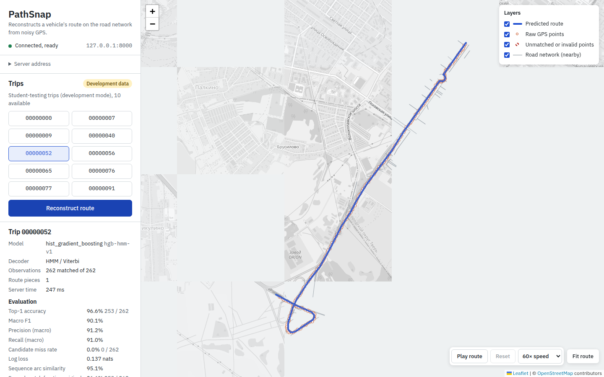
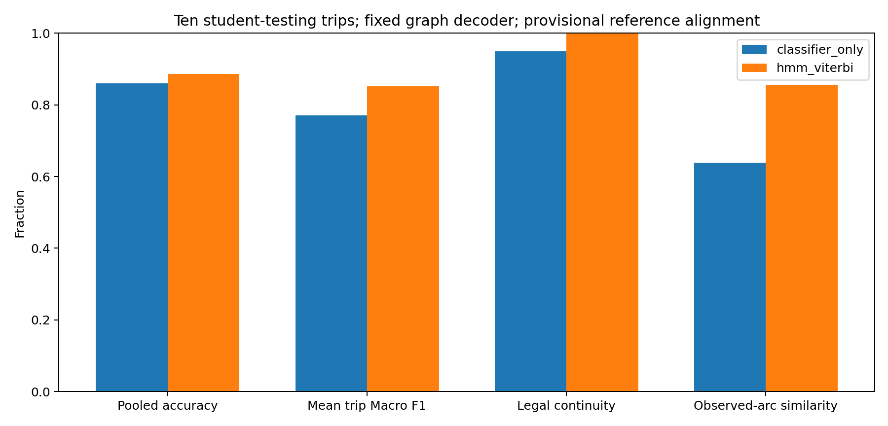
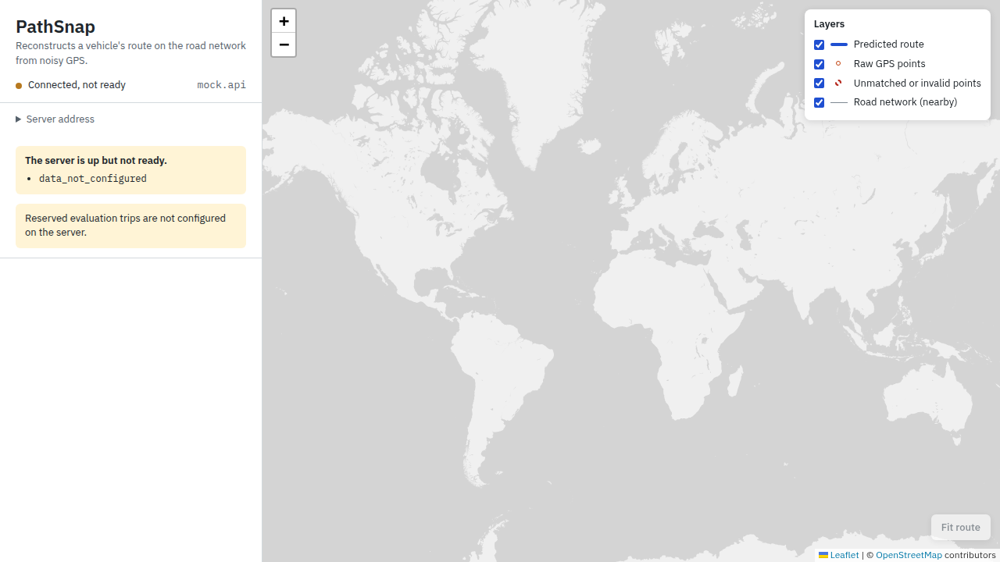

# PathSnap: map-matching and route reconstruction

**UE24CS352A Machine Learning hackathon, PES University (RR Campus).**

**Team PT-081 (Section F):** Vismay H S (PES1UG24AM325), Vismaya G (PES1UG24AM326), Vudutha Kundhan (PES1UG24AM327), Y B Halli Viswanathareddy Bhavana (PES1UG24AM328).

**Technical report (PDF):** [PathSnap_Technical_Report.pdf](report/PathSnap_Technical_Report.pdf) ([download](https://github.com/VismayHS/PathSnap_ML_Hackathon_81/raw/main/report/PathSnap_Technical_Report.pdf)).

PathSnap takes a vehicle's noisy GPS trace and works out which road it was actually on at each moment. For every GPS point it finds nearby road segments, scores each one with a trained classifier, and then uses an HMM with Viterbi decoding to choose a connected, drivable sequence of roads on the trip's directed road network. Laptop 1 runs the model behind a FastAPI service. Laptop 2 runs a React interface where the evaluator picks a trip and sees the reconstructed route and its accuracy.



---

## Contents

1. [Results](#results)
2. [How it works](#how-it-works)
3. [Maps and screenshots](#maps-and-screenshots)
4. [Run the demo](#run-the-demo)
5. [Reproduce the experiments](#reproduce-the-experiments)
6. [Repository layout](#repository-layout)
7. [Documentation](#documentation)
8. [Integrity and AI assistance](#integrity-and-ai-assistance)

---

## Results

### Final evaluation: the 10 reserved evaluator trips

The reserved trips were run **once**, on the frozen final system (commit `603b42f`, model `hgb-hmm-v1`), through the API in evaluator mode. Scoring happened only on the server, after prediction. Nothing was explored, trained, tuned or re-selected using these trips, and only aggregate metrics are kept: [`results/system/evaluator-run-01-aggregate.json`](results/system/evaluator-run-01-aggregate.json).

| Trip | Points | Top-1 accuracy | Macro F1 | Route continuity | Route pieces | Server time |
|---|---|---|---|---|---|---|
| 00000015 | 6,854 | 79.0% | 0.426 | 99.94% | 5 | 2.8 s |
| 00000017 | 1,346 | 87.5% | 0.764 | 99.93% | 2 | 2.3 s |
| 00000023 | 458 | 91.3% | 0.669 | 100.00% | 1 | 0.4 s |
| 00000030 | 654 | 81.8% | 0.759 | 100.00% | 1 | 0.8 s |
| 00000049 | 2,642 | 98.1% | 0.952 | 99.96% | 2 | 2.0 s |
| 00000059 | 1,031 | 91.0% | 0.763 | 100.00% | 1 | 1.3 s |
| 00000067 | 916 | 95.5% | 0.879 | 100.00% | 1 | 0.6 s |
| 00000073 | 1,144 | 95.8% | 0.896 | 100.00% | 6 | 1.1 s |
| 00000087 | 1,399 | 98.1% | 0.960 | 100.00% | 1 | 2.7 s |
| 00000094 | 3,230 | 88.5% | 0.794 | 99.94% | 3 | 3.6 s |
| **All 10** | **19,674** | **87.8%** (pooled) | **0.786** (mean) | **99.96%** (pooled) | **23** | |

- **87.8% Top-1 accuracy on trips the system had never seen**, in line with the 88.5% on the student-test trips, so the model generalises.
- **99.96% route continuity:** the predicted routes are almost entirely connected and drivable.
- Four trips scored above 95% accuracy, and five trips were reconstructed as a single connected route.


### Five models compared

All five models use the same candidate features. Each was evaluated with 5-fold **grouped** cross-validation over the 80 training trips (a trip never appears in both training and validation), then refit on all training trips and run on the 10 student-test trips. Source: [`results/experiments/baselines-local-v1/summary.json`](results/experiments/baselines-local-v1/summary.json).

| Model | Family | CV Macro F1 | Student-test Top-1 accuracy | Student-test Macro F1 | Student-test log loss | Route continuity | Total time |
|---|---|---|---|---|---|---|---|
| Logistic Regression | regularised linear | 0.635 ± 0.017 | 81.7% | 0.650 | 0.573 | 93.6% | 24 s |
| Distance-weighted KNN | instance based | 0.666 ± 0.016 | 83.8% | 0.706 | 0.866 | 94.1% | 303 s |
| Random Forest | bagged trees | 0.721 ± 0.019 | 85.9% | 0.766 | 0.373 | 94.9% | 161 s |
| Extra Trees | extremely randomised trees | 0.703 ± 0.016 | 85.3% | 0.736 | 0.415 | 95.0% | 41 s |
| **HistGradientBoosting (selected)** | histogram gradient boosting | **0.725 ± 0.017** | 85.8% | 0.767 | **0.361** | 95.1% | 26 s |

HistGradientBoosting was **selected on training cross-validation Macro F1**, where it scored highest, and it was also one of the fastest models and had the lowest log loss. Selection used cross-validation, not test results. The reasoning is in [`docs/ml/model-selection.md`](docs/ml/model-selection.md). Model fitting uses at most 400 scorable points per training trip; validation and testing use every point.

### Bayesian tuning (Optuna TPE)

12 trials: 4 random start-up trials, then 8 trials guided by the earlier results. Each trial was a full 5-fold grouped cross-validation on the training trips only. The CV Macro F1 went from **0.7252 (untuned) to 0.7297 (tuned)**. The full study and every trial are in [`results/hpo/hgb-tpe-v1/`](results/hpo/hgb-tpe-v1/).

### Effect of HMM/Viterbi decoding (student-test trips)

Source: [`results/hmm/hgb-hmm-v1/summary.json`](results/hmm/hgb-hmm-v1/summary.json).

| 10 student-test trips (19,143 scorable points) | Tuned classifier only | **Tuned classifier + HMM/Viterbi (final)** |
|---|---|---|
| Top-1 accuracy | 86.0% | **88.5%** |
| Macro F1 (per trip, averaged) | 0.771 | **0.851** |
| Precision (macro) | 0.795 | **0.865** |
| Recall (macro) | 0.769 | **0.857** |
| Route continuity | 95.0% | **99.9%** |
| Candidate miss rate | 0.4% | 0.4% |
| Log loss (classifier scores) | 0.352 | 0.352 |
| Disconnected route pieces (all 10 trips) | 974 | **28** |

- The HMM turns a fragmented route (974 pieces) into an almost fully connected one (28 pieces).
- It raises accuracy by 2.5 points and Macro F1 by 0.08.
- Log loss is identical because it measures the classifier's scores, which the HMM does not change.

| CV Macro F1 of all five models | Classifier only vs HMM |
|---|---|
|  |  |
| **Bayesian optimisation history** | **Tuned vs untuned** |
|  |  |

---

## How it works

```
GPS trace (.track) + road network (.nodes/.arcs)        <- the .route reference is never used here
        │
        ▼
1. Clean      keep every original row; invalid points are marked, never silently dropped
2. Candidates up to 8 road segments within 100 m of each point (spatial index, in metres)
3. Features   distance, heading agreement, position along the segment, segment length, speed, time gap
4. Classifier tuned HistGradientBoosting scores each candidate
5. HMM        hidden states = candidate roads; emissions = classifier scores;
              transitions = driving distance on the road network vs distance the GPS moved
6. Viterbi    best connected sequence; long gaps or unreachable steps start a new piece
              instead of inventing roads
7. Route      built only from real road segments
        │
        ▼
Separately, on the server only: the scorer compares the finished prediction with the
reference route and returns aggregate metrics. The UI never receives the reference route.
```

- **Labels.** A `.route` file lists the roads travelled in order; it is not one label per GPS point. Per-point labels for training and scoring come from an order-preserving alignment: [`docs/ml/scoring-policy.md`](docs/ml/scoring-policy.md).
- **Data partitions.** 80 training trips for fitting, cross-validation and tuning. 10 student-test trips for comparison. 10 reserved evaluator trips for the final evaluation only.
- **Method details:** [`docs/ml/hmm-method.md`](docs/ml/hmm-method.md) and the report.

---

## Maps and screenshots


Layers: **blue** classifier + HMM route, **purple dashed** classifier only, **green** reference route (development trips only), **orange** raw GPS points, **grey** nearby road network.

The interactive maps for all 10 student-test trips are in [`maps/hgb-hmm-v1/`](maps/hgb-hmm-v1/). To view them, run `python3 -m http.server 8001 --directory maps/hgb-hmm-v1` and open <http://localhost:8001/>.

| UI on a phone-sized screen | Error state with request ID and retry | Evaluator data not provided: no substitute trips |
|---|---|---|
|  |  |  |

All screenshots are real captures of the trained model. The error screenshot uses a simulated server error from the browser tests.

---

## Run the demo

**You need:** Python 3.12, Node 20+, and the dataset folder (`Student_folder/` with `train/` and `student_test/`). The data is not in this repository.

### Laptop 1: model and API

```bash
git clone https://github.com/VismayHS/PathSnap_ML_Hackathon_81.git && cd PathSnap_ML_Hackathon_81
python3 -m venv .venv && .venv/bin/python -m pip install -r requirements.lock.txt

export PATHSNAP_MODE=development                          # or: evaluator (see below)
export PATHSNAP_DATA_ROOT=/absolute/path/to/Student_folder
export PATHSNAP_BUNDLE_ROOT="$PWD/artifacts/hgb-hmm-v1"   # the final trained model
# Browser addresses allowed to call the API. This replaces the default list,
# so include every address the UI will be opened from.
export PATHSNAP_CORS_ORIGINS="http://<LAPTOP2-IP>:4173,http://localhost:4173,http://127.0.0.1:4173"
.venv/bin/python -m uvicorn api.main:app --host 0.0.0.0 --port 8000
```

For the reserved trips, set `PATHSNAP_MODE=evaluator` and `PATHSNAP_EVALUATOR_ROOT=/absolute/path/to/evaluator_test`. Check the API with `curl http://127.0.0.1:8000/health`; it should show `"ready": true`.

### Laptop 2: evaluator UI

```bash
cd PathSnap_ML_Hackathon_81/ui
npm ci
echo "VITE_PATHSNAP_API_URL=http://<LAPTOP1-IP>:8000" > .env.local
npm run build && npm run preview    # open http://localhost:4173
```

On one machine, use `127.0.0.1` for both addresses. Windows commands, firewall settings and troubleshooting are in [**docs/deployment/two-laptops.md**](docs/deployment/two-laptops.md).

### API

- `GET /health`: readiness, mode and model.
- `GET /trips`: the trip IDs allowed in the current mode.
- `POST /predict {"trip_id": "00000052"}`: the predicted route, a status for every GPS point, timings and the aggregate metrics.

Every response carries an `X-Request-ID` that also appears in Laptop 1's log. The full contract is in [`contracts/interfaces.md`](contracts/interfaces.md).

---

## Reproduce the experiments

```bash
# 0. environment and tests
.venv/bin/python -m pip install -r requirements.lock.txt
.venv/bin/python -m pytest tests -q

# 1. validate all 90 permitted trips and run the EDA
.venv/bin/python -m src.data_processing.inspect --data-root $PATHSNAP_DATA_ROOT --output results/eda/my-run

# 2. build the candidate/feature cache and the grouped folds
.venv/bin/python -m src.models.prepare --data-root $PATHSNAP_DATA_ROOT --cache data/processed/candidate-v1 --evidence results/eda/preparation-my-run

# 3. five-model grouped cross-validation and student-test runs (about 9 min at 2 threads)
.venv/bin/python -m src.models.experiments --cache data/processed/candidate-v1 --output results/experiments/my-baselines

# 4. Bayesian tuning of the selected model (12 Optuna TPE trials, about 3 min)
.venv/bin/python -m src.hpo.search --cache data/processed/candidate-v1 --output results/hpo/my-tpe --trials 12 --threads 4

# 5. classifier only vs HMM on the student-test trips, and export the model bundle
#    (point --baseline/--hpo at my-baselines and my-tpe to use your own runs)
.venv/bin/python -m src.hmm.compare --data-root $PATHSNAP_DATA_ROOT \
    --baseline results/experiments/baselines-local-v1/summary.json --hpo results/hpo/hgb-tpe-v1/summary.json \
    --bundle-output artifacts/my-bundle --output results/hmm/my-comparison

# 6. Folium maps and the report PDF
.venv/bin/python -m src.visualisation.folium.make_maps --input results/hmm/hgb-hmm-v1/visualisation --output maps/my-maps
.venv/bin/python -m src.evaluation.scientific_report   # regenerates the scientific tables from saved results (report/build/)
.venv/bin/python scripts/build_report.py
```

The exact run IDs behind every committed result are in [`docs/ml/reproduce.md`](docs/ml/reproduce.md). Every results folder records its source commit, data fingerprint, seed, configuration and timings.

---

## Repository layout

| Folder | What's inside |
|---|---|
| `src/data_processing/` | Reading and validating trip files, cleaning, metre geometry, candidate search |
| `src/features/` | Candidate features |
| `src/models/` | The five models, cross-validation runner, model export |
| `src/hpo/` | Bayesian optimisation with Optuna TPE |
| `src/hmm/` | Directed road graph, Viterbi decoder, classifier vs HMM comparison |
| `src/evaluation/` | Label alignment, the server-side scorer, metrics, confusion matrices |
| `src/visualisation/` | Plots (`plots/`) and the Folium map generator (`folium/`) |
| `src/pipeline.py` | The single prediction path used by the API and the command line |
| `api/` | FastAPI service (Laptop 1) |
| `ui/` | React + TypeScript evaluator UI (Laptop 2), with browser tests in `ui/tests/` |
| `artifacts/hgb-hmm-v1/` | The final trained model, with checksums verified at API startup |
| `results/` | Records, summaries, figures and logs for every experiment |
| `maps/` | Interactive Folium maps for the 10 student-test trips |
| `report/` | The technical report PDF and its sources |
| `configs/`, `contracts/` | Data and experiment settings; interfaces between pipeline, API and UI |
| `tests/` | Science, API (contract and leakage) and integration tests |
| `docs/` | Method notes and the deployment guide |

---

## Documentation

| Topic | Read |
|---|---|
| Full write-up | [`report/PathSnap_Technical_Report.pdf`](report/PathSnap_Technical_Report.pdf) |
| Data, labels and scoring | [`docs/ml/scoring-policy.md`](docs/ml/scoring-policy.md), [`data/README.md`](data/README.md) |
| Model choice | [`docs/ml/model-selection.md`](docs/ml/model-selection.md) |
| HMM and Viterbi | [`docs/ml/hmm-method.md`](docs/ml/hmm-method.md) |
| Two-laptop deployment | [`docs/deployment/two-laptops.md`](docs/deployment/two-laptops.md) |

---

## Integrity and AI assistance

- **Independent work.** No code, weights or results were shared with or taken from other teams.
- **Evidence.** Every number here and in the report comes from code and run records in this repository.
- **Evaluator data.** The reserved trips were never used for training, tuning or model selection. Their reference routes never leave the server's scoring step. The development Folium maps in `maps/` show reference routes for student-test trips only, and are not used by the API or UI.
- **AI assistance.** AI coding assistants were used substantially, under the team's direction. The disclosure statement is in the report.
