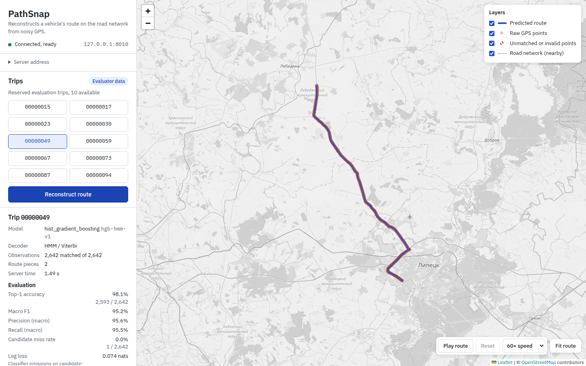
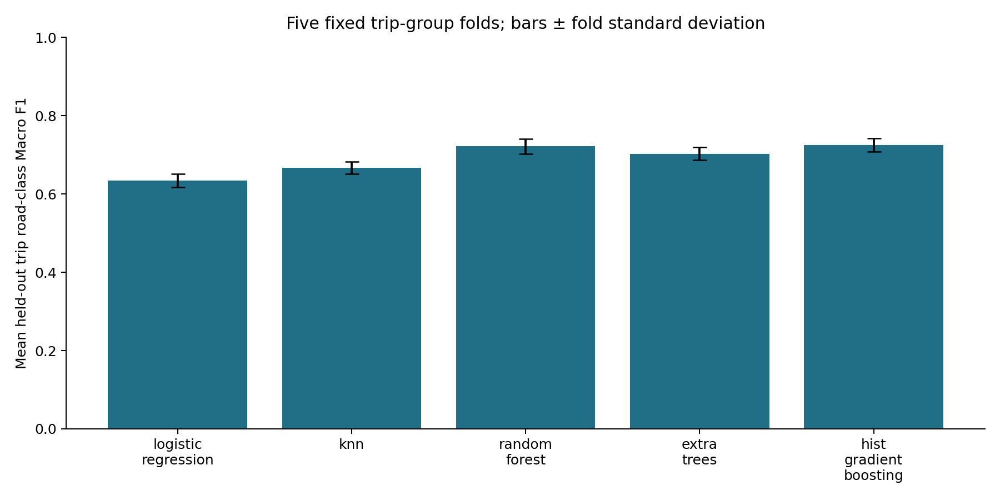
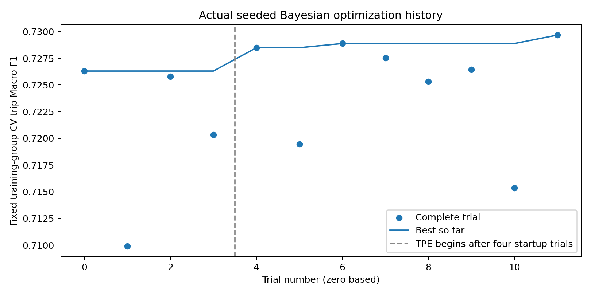
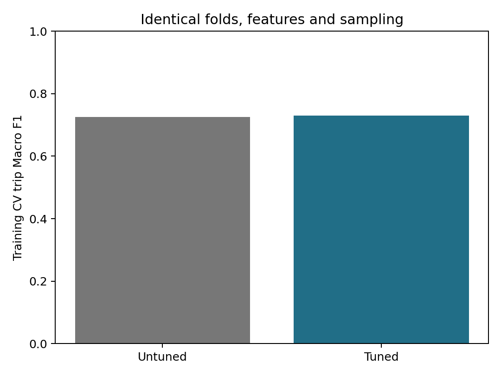
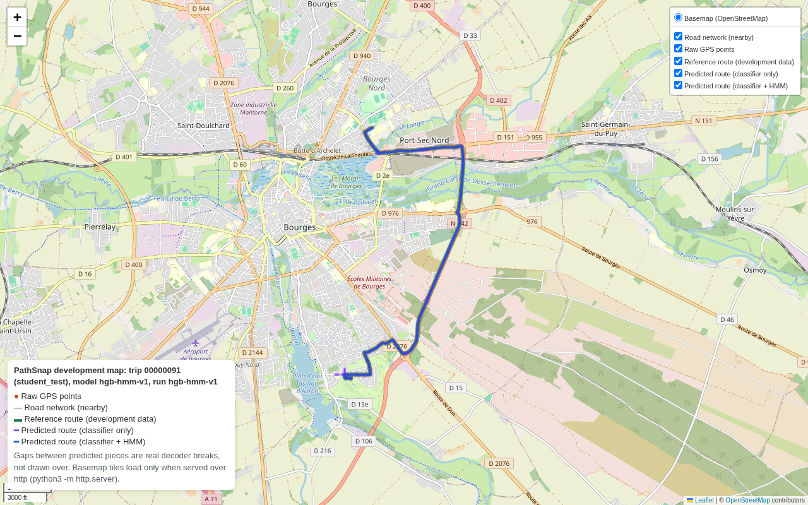
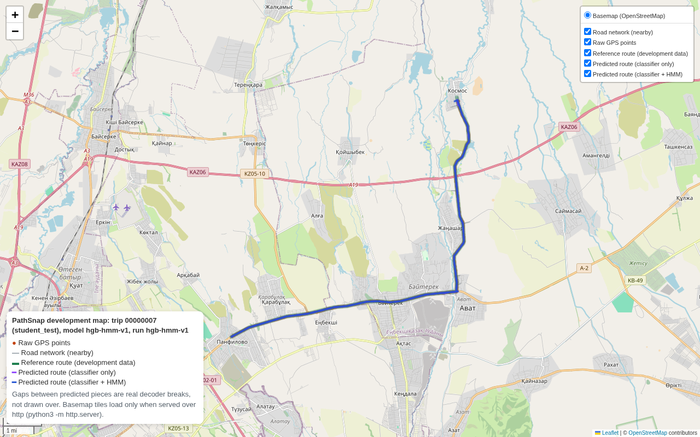
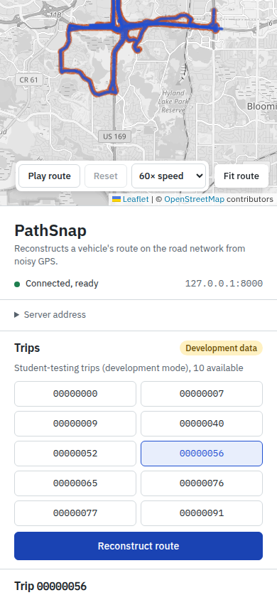
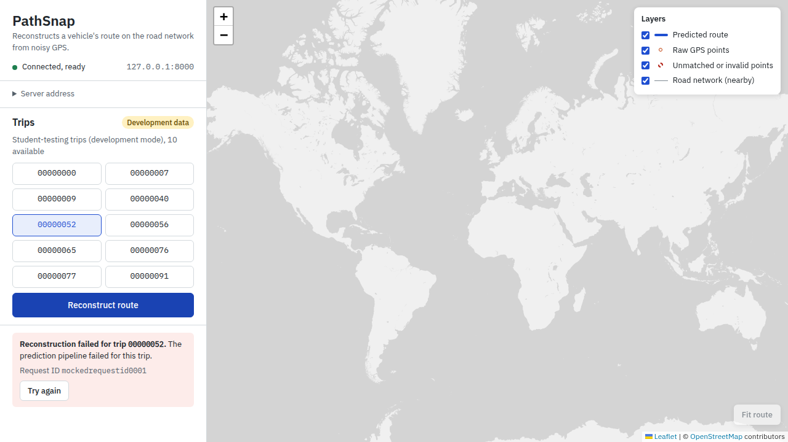

# PathSnap: map-matching and route reconstruction

**UE24CS352A Machine Learning hackathon, PES University (RR Campus).**

PathSnap takes a vehicle's noisy GPS trace and works out which road segments it actually drove on. For each GPS point it finds nearby road segments, scores them with a trained classifier, and then uses an HMM with Viterbi decoding to choose the most plausible sequence of road segments, as feasible route pieces on the supplied directed road graph. The final model leaves 28 pieces across the 10 student-test trips. Turn restrictions and traffic rules are not available in the data. Laptop 1 runs the model behind a FastAPI service. Laptop 2 runs a React interface where an evaluator picks a trip and sees the reconstructed route and its accuracy.


> Development numbers come from 80 training trips and 10 student-test trips. The **final evaluation** on the 10 reserved evaluator trips is reported separately below. The pointwise scoring definition is **provisional** until the organisers confirm the official one.

---

## Contents

1. [Results at a glance](#results-at-a-glance), including the [final evaluation](#final-evaluation-the-10-reserved-evaluator-trips)
2. [How it works](#how-it-works)
3. [Screenshots](#screenshots)
4. [Quick start: run the demo](#quick-start-run-the-demo)
5. [Reproduce the experiments](#reproduce-the-experiments)
6. [Repository layout](#repository-layout)
7. [Documentation map](#documentation-map)
8. [Project status and pending items](#project-status-and-pending-items)
9. [Integrity and AI assistance](#integrity-and-ai-assistance)

---

## Results at a glance

### Five models compared

Every model was trained on the same candidate features and evaluated with 5-fold **grouped** cross-validation over the 80 training trips: a trip's points never appear in both training and validation. Each model was then refit on all training trips and run on the 10 student-test trips. Source: [`results/experiments/baselines-local-v1/summary.json`](results/experiments/baselines-local-v1/summary.json).

| Model | Family | CV Macro F1 (80 train trips, 5 grouped folds) | Student-test Top-1 accuracy | Student-test Macro F1 | Student-test log loss | Route continuity (student test) | Total experiment time |
|---|---|---|---|---|---|---|---|
| Logistic Regression | regularized linear | 0.635 ± 0.017 | 81.7% | 0.650 | 0.573 | 93.6% | 24 s |
| Distance-weighted KNN | instance based | 0.666 ± 0.016 | 83.8% | 0.706 | 0.866 | 94.1% | 303 s |
| Random Forest | bagged randomized trees | 0.721 ± 0.019 | 85.9% | 0.766 | 0.373 | 94.9% | 161 s |
| Extra Trees | extremely randomized trees | 0.703 ± 0.016 | 85.3% | 0.736 | 0.415 | 95.0% | 41 s |
| **HistGradientBoosting (selected)** | histogram gradient boosting | **0.725 ± 0.017** | 85.8% | 0.767 | **0.361** | 95.1% | 26 s |

HistGradientBoosting was **selected on training cross-validation Macro F1** (the primary criterion), together with its low compute cost. It also had the lowest observed conditional log loss on the student-test trips, but that observation is descriptive only: the scores are not calibrated probabilities. The reasoning is in [`docs/ml/model-selection.md`](docs/ml/model-selection.md).

"Total experiment time" covers grouped CV, the refit, student-test scoring and the reference metrics, at 2 threads. Model fitting uses at most 400 scorable observations per training trip; validation and student-test scoring use every observation.

### Bayesian tuning (Optuna TPE)

There were 12 trials, each a full 5-fold grouped cross-validation. The CV Macro F1 went from **0.7252 (untuned) to 0.7297 (tuned)**. The tuning process ended unexpectedly with exit code 143 after 11 trials; the cause was not verified. The 12th trial was then completed from its recorded parameters. This is documented, not hidden. Source: [`results/hpo/hgb-tpe-v1/`](results/hpo/hgb-tpe-v1/).

### Final evaluation: the 10 reserved evaluator trips

The organisers' reserved evaluator trips were run **once** on the frozen accepted M3 system (`main` `603b42f`, model `hgb-hmm-v1`), before the M4 documentation was promoted, through the API in evaluator mode, with server-side scoring only. Nothing was explored, trained, tuned or re-selected using them. Only aggregate metrics are kept: [`results/system/evaluator-run-01-aggregate.json`](results/system/evaluator-run-01-aggregate.json).

| Trip | Points | Top-1 accuracy | Macro F1 | Route continuity | Route pieces | Server time |
|---|---|---|---|---|---|---|
| 00000015 | 6,854 | 79.0% | 0.426 | 99.94% | 5 | 2.8 s |
| 00000017 | 1,346 | 87.5% | 0.764 | 99.93% | 2 | 2.3 s |
| 00000023 | 458 | 91.3% | 0.669 | 100.00% | 1 | 0.4 s |
| 00000030 | 654 | 81.8% | 0.759 | 100.00% | 1 | 0.8 s |
| 00000049 | 2,642 | 98.1% | 0.952 | 99.96% | 2 | 2.0 s |
| 00000059 | 1,031 | 91.0% | 0.763 | 100.00% | 1 | 1.3 s |
| 00000067 | 916 | 95.5% | 0.879 | 100.00% | 1 | 0.6 s |
| 00000073 | 1,144 | 95.8% | 0.896 | 100.00% | 6 | 1.1 s |
| 00000087 | 1,399 | 98.1% | 0.960 | 100.00% | 1 | 2.7 s |
| 00000094 | 3,230 | 88.5% | 0.794 | 99.94% | 3 | 3.6 s |
| **All 10** | **19,674** | **87.8%** (pooled) | **0.786** (mean) | **99.96%** (pooled) | **23** | |

- **Overall:** 87.8% Top-1 accuracy on unseen trips, close to the 88.5% on the student-test trips.
- **Macro F1 is lower** (0.786 against 0.851), mostly because of trip `00000015`: a long trip where common roads are right but many rarely visited segments are missed.
- **Candidate misses:** 128 points (0.65%) had no correct road among their candidates. They count as errors.
- **Scoring policy:** the same provisional `pathsnap-scoring-v0`.



### Final system on the student-test trips: tuned classifier with and without HMM/Viterbi

Source: [`results/hmm/hgb-hmm-v1/summary.json`](results/hmm/hgb-hmm-v1/summary.json).

| Student-test (10 trips: 19,160 GPS rows, 19,143 scorable, 17 unscorable) | Tuned classifier only | **Tuned classifier + HMM/Viterbi (final)** |
|---|---|---|
| Top-1 accuracy | 86.0% | **88.5%** |
| Macro F1 (per trip, averaged) | 77.1% | **85.1%** |
| Precision (macro) | 79.5% | **86.5%** |
| Recall (macro) | 76.9% | **85.7%** |
| Route continuity | 95.0% | **99.9%** |
| Candidate miss rate | 0.4% | 0.4% |
| Log loss (classifier emissions) | 0.352 | 0.352 |
| Disconnected route pieces (all 10 trips) | 974 | **28** |

- Accuracy is computed over the 19,143 scorable points. The 84 scorable points whose true road was not among the candidates count as errors; they are not dropped.
- The HMM turns a fragmented route into an almost fully connected one and improves accuracy overall.
- **It does not help on every trip.** On trip `00000007`, Top-1 accuracy fell from 94.8% to 88.3%. The report documents this regression; its specific cause has not been established.
- Log loss is identical because it measures the classifier's probabilities, which the HMM does not change.
- The student-test trips were looked at while choosing the model, so these are development results, not an unbiased final test.

| CV Macro F1 of all five models | Classifier-only vs HMM on the student-test trips |
|---|---|
|  |  |
| **Bayesian optimisation history** | **Tuned vs untuned** |
|  |  |

---

## How it works

```
GPS trace (.track) + road network (.nodes/.arcs)        <- the .route reference is never used here
        │
        ▼
1. Clean      keep every original row index; invalid points are marked, never silently dropped
2. Candidates up to 8 road segments within 100 m of each point (spatial index, metres)
3. Features   distance to segment, heading agreement, projection fraction, segment length, speed, time gap
4. Classifier tuned HistGradientBoosting scores each candidate (normalised score, not a probability)
5. HMM        hidden states = candidates; emissions = classifier scores;
              transitions = road-network distance vs straight-line distance and elapsed time
6. Viterbi    most likely connected sequence; long gaps or unreachable steps restart decoding
              instead of inventing roads
7. Geometry   the predicted route is built from real road segments; pieces are never bridged with straight lines
        │
        ▼
Separately, on the server only: the scorer compares the finished prediction with the
reference route and returns aggregate metrics. The UI never receives reference geometry or per-point answers.
```

- **Labels.** The `.route` file lists the arcs travelled in order. It is *not* one label per GPS point. A derives per-point training labels with an order-preserving alignment; see [`docs/ml/scoring-policy.md`](docs/ml/scoring-policy.md).
- **Partitions.** 80 training trips are used for fitting, cross-validation and tuning. 10 student-test trips are used for comparison. The 10 evaluator trips are reserved for the final demo and never looked at.
- **Deeper explanations** for the viva are in [`docs/ml/viva-notes.md`](docs/ml/viva-notes.md) and [`docs/ml/hmm-method.md`](docs/ml/hmm-method.md).

---

## Screenshots

| Folium development map (student-test trip 00000091) | Trip 00000007: where the HMM did *not* help |
|---|---|
|  |  |

Map layers:
- **Blue:** classifier + HMM route.
- **Purple dashed:** classifier only.
- **Green:** reference route (development data only).
- **Orange:** raw GPS points.
- **Grey:** nearby road network.

The interactive maps for all 10 trips are in [`maps/hgb-hmm-v1/`](maps/hgb-hmm-v1/). To view them, run `python3 -m http.server 8001 --directory maps/hgb-hmm-v1` and open <http://localhost:8001/>.

| Evaluator UI on a phone-sized screen | Error state with request ID and retry | Evaluator data not provided: no substitute trips |
|---|---|---|
|  |  |  |

All UI screenshots are real captures from a one-machine run using the trained model in development mode. The error screenshot uses a simulated server error from the browser tests.

---

## Quick start: run the demo

**What you need:** Python 3.12, Node 20+, and the dataset folder (`Student_folder/` with `train/` and `student_test/`). The data is not in this repository.

### Laptop 1: model and API

```bash
git clone https://github.com/VismayHS/PathSnap_ML_Hackathon_81.git && cd PathSnap_ML_Hackathon_81
python3 -m venv .venv && .venv/bin/python -m pip install -r requirements.lock.txt

export PATHSNAP_MODE=development                       # 'evaluator' once the reserved trips are provided
export PATHSNAP_DATA_ROOT=/absolute/path/to/Student_folder
export PATHSNAP_BUNDLE_ROOT=$PWD/artifacts/hgb-hmm-v1  # the final trained model
# Browser origins allowed to call the API (keep the quotes). Setting this replaces the default list,
# so include every address the UI will be opened from.
export PATHSNAP_CORS_ORIGINS="http://<LAPTOP2-IP>:4173,http://localhost:4173,http://127.0.0.1:4173"
.venv/bin/python -m uvicorn api.main:app --host 0.0.0.0 --port 8000
```

Check it: `curl http://127.0.0.1:8000/health` should show `"ready": true`.

### Laptop 2: evaluator UI

```bash
cd PathSnap_ML_Hackathon_81/ui
npm ci
echo "VITE_PATHSNAP_API_URL=http://<LAPTOP1-IP>:8000" > .env.local
npm run build && npm run preview    # open http://localhost:4173 (or http://<LAPTOP2-IP>:4173)
```

On one machine, use `127.0.0.1` for both addresses. The browser address must be one of the origins in `PATHSNAP_CORS_ORIGINS`, otherwise the UI shows "Can't reach the PathSnap server". Windows commands, firewall and CORS troubleshooting, and the demo-day checklist are in [**docs/deployment/two-laptops.md**](docs/deployment/two-laptops.md).

### API in one paragraph

- `GET /health` reports readiness, the mode and the model.
- `GET /trips` lists the allowed trip IDs for the mode.
- `POST /predict {"trip_id": "00000052"}` returns the predicted route, a status for every GPS point, timings and the aggregate metrics.

Every response carries an `X-Request-ID` that also appears in the Laptop 1 log. The full contract is in [`contracts/interfaces.md`](contracts/interfaces.md) and [`contracts/http.schema.json`](contracts/http.schema.json).

---

## Reproduce the experiments

```bash
# 0. environment and tests
.venv/bin/python -m pip install -r requirements.lock.txt
.venv/bin/python -m pytest tests -q

# 1. validate all 90 permitted trips and run the EDA
.venv/bin/python -m src.data_processing.inspect --data-root $PATHSNAP_DATA_ROOT --output results/eda/my-run

# 2. build the candidate/feature cache and grouped split (training labels are built here, isolated from inference)
.venv/bin/python -m src.models.prepare --data-root $PATHSNAP_DATA_ROOT --cache data/processed/candidate-v1 --evidence results/eda/preparation-my-run

# 3. five-model grouped cross-validation and student-test refits (about 9 min at 2 threads)
.venv/bin/python -m src.models.experiments --cache data/processed/candidate-v1 --output results/experiments/my-baselines

# 4. Bayesian tuning of the selected model (12 Optuna TPE trials, about 3 min)
.venv/bin/python -m src.hpo.search --cache data/processed/candidate-v1 --output results/hpo/my-tpe --trials 12 --threads 4

# 5. classifier-only vs HMM on the 10 student-test trips, then export the final bundle
#    (to regenerate everything from your own fresh runs, point --baseline/--hpo at my-baselines and my-tpe;
#     the paths below reuse the recorded runs that produced the committed results)
.venv/bin/python -m src.hmm.compare --data-root $PATHSNAP_DATA_ROOT \
    --baseline results/experiments/baselines-local-v1/summary.json --hpo results/hpo/hgb-tpe-v1/summary.json \
    --bundle-output artifacts/my-bundle --output results/hmm/my-comparison

# 6. Folium maps, then the report PDF
.venv/bin/python -m src.visualisation.folium.make_maps --input results/hmm/hgb-hmm-v1/visualisation --output maps/my-maps
.venv/bin/python -m src.evaluation.scientific_report       # regenerates report/sections/science.md from saved results
.venv/bin/python scripts/build_report.py                   # -> report/PathSnap_Technical_Report.pdf
```

The full command list with the exact run IDs used is in [`docs/ml/reproduce.md`](docs/ml/reproduce.md). Every result folder records the source commit, data fingerprint, seed, configuration and timings.

---

## Repository layout

| Folder | What's inside |
|---|---|
| `src/data_processing/` | Loading and strict parsing of trip files, cleaning, metre geometry, candidate search |
| `src/features/` | Candidate features (distance, heading, projection, length, speed, time gap) |
| `src/models/` | The five models, training/cross-validation runner, bundle export, optional multi-laptop worker |
| `src/hpo/` | Bayesian optimisation with Optuna TPE |
| `src/hmm/` | Directed road graph, Viterbi decoder, classifier vs HMM comparison |
| `src/evaluation/` | Label alignment, the isolated server-side scorer, metrics, confusion matrices, report generator |
| `src/pipeline.py` | The single prediction path used by both the command line and the API |
| `src/contracts.py`, `contracts/` | Versioned interfaces between pipeline, API and UI (plus a schema hash) |
| `src/visualisation/` | Scientific plots (`plots/`) and Folium map generator (`folium/`) |
| `api/` | FastAPI service (Laptop 1) |
| `ui/` | React + TypeScript + Vite evaluator UI (Laptop 2), with Playwright browser tests in `ui/tests/` |
| `artifacts/` | Saved model bundles: `hgb-hmm-v1` (final) and `diagnostic-v1` (wiring-only placeholder) |
| `results/` | Every experiment's records, summaries, figures and logs (EDA, baselines, HPO, HMM, system) |
| `maps/` | Interactive Folium HTML maps for the 10 student-test trips |
| `report/` | Technical report sources and the PDF build |
| `configs/` | Data and experiment configuration |
| `tests/` | `tests/ml` (science), `tests/api` (API contract and leakage), `tests/integration` (maps) |
| `docs/` | Team guide, ML method notes, deployment, UI research, requirement tracking |
| `scripts/` | Contract hash, report build, context snapshot |

---

## Documentation map

| If you want to… | Read |
|---|---|
| Read the technical report (PDF, sections 2–7) | [`report/PathSnap_Technical_Report.pdf`](report/PathSnap_Technical_Report.pdf); sources in [`report/sections/`](report/sections/) |
| Get a plain-language overview and see progress | [`docs/team/README.md`](docs/team/README.md), [`docs/team/progress-log.md`](docs/team/progress-log.md), [`docs/team/glossary.md`](docs/team/glossary.md) |
| Prepare for the viva | [`docs/ml/viva-notes.md`](docs/ml/viva-notes.md), [`docs/ml/team-understanding.md`](docs/ml/team-understanding.md) |
| Understand the data and labels | [`docs/ml/scoring-policy.md`](docs/ml/scoring-policy.md), [`data/README.md`](data/README.md) |
| Understand the model choice | [`docs/ml/model-selection.md`](docs/ml/model-selection.md) |
| Understand the HMM | [`docs/ml/hmm-method.md`](docs/ml/hmm-method.md) |
| Check scientific claims against evidence | [`docs/ml/scientific-audit.md`](docs/ml/scientific-audit.md) |
| Run the demo on two laptops | [`docs/deployment/two-laptops.md`](docs/deployment/two-laptops.md) |
| See the UI design decisions | [`DESIGN.md`](DESIGN.md), [`docs/ui-research.md`](docs/ui-research.md) |
| See which PDF requirement is done where | [`docs/requirements-traceability.md`](docs/requirements-traceability.md) |
| See the external tools and repositories consulted | [`docs/repository-references-app.md`](docs/repository-references-app.md), [`docs/repository-references-ml.md`](docs/repository-references-ml.md) |
| Read the original build instructions and coordination log | [`docs/team/context/`](docs/team/context/) |

---

## Project status and pending items

| Milestone | Status |
|---|---|
| M0: setup and interfaces | ✅ on `main` |
| M1: end-to-end slice (diagnostic model) | ✅ on `main` |
| M2: five models, grouped CV, model selection | ✅ on `main` |
| M3: Bayesian tuning, HMM, trained model in the API and UI, Folium maps | ✅ on `main` |
| M4: technical report PDF, feature ablation, final audit | ✅ on `main` |
| Final evaluation on the 10 reserved trips (evaluator mode, frozen model) | ✅ run, aggregate results above |

**Pending outside the code (team or organisers):**
- [ ] Official pointwise scoring definition from the organisers (our metrics are provisional until then).
- [x] The 10 reserved evaluator trips: received and run. For the demo, set `PATHSNAP_MODE=evaluator` and `PATHSNAP_EVALUATOR_ROOT=/path/to/evaluator_test`; the data stays outside the repository.
- [ ] A rehearsal on two physical laptops, and real terminal screenshots for the report.
- [ ] Team names and SRNs, plus the team's AI-assistance statement in the report.

---

## Integrity and AI assistance

- **Independent work.** This project was built for this team only and shares no code, weights or results with other teams.
- **Evidence.** Every number in this README and the report is produced by code in this repository and recorded with its source commit.
- **Evaluator data.** The reserved evaluator trips are never used for training or tuning. Evaluator reference routes never leave the server's scoring step. The development Folium maps in `maps/` do show development (train/student-test) reference routes, but they are kept separate from the API and UI.
- **AI assistance.** AI coding assistance was used to build this project. The instructions given to it and the coordination log are in [`docs/team/context/`](docs/team/context/). The team's own disclosure statement goes in the report, as the event policy requires.
